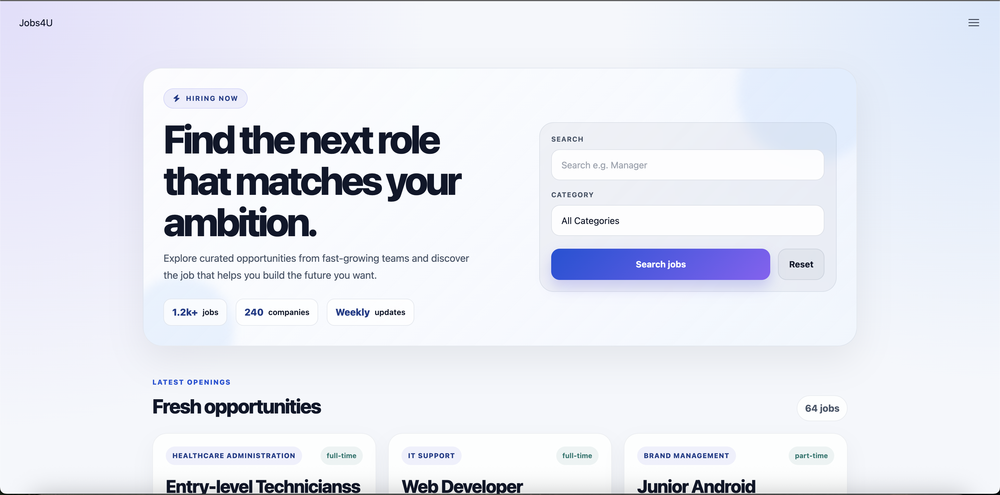
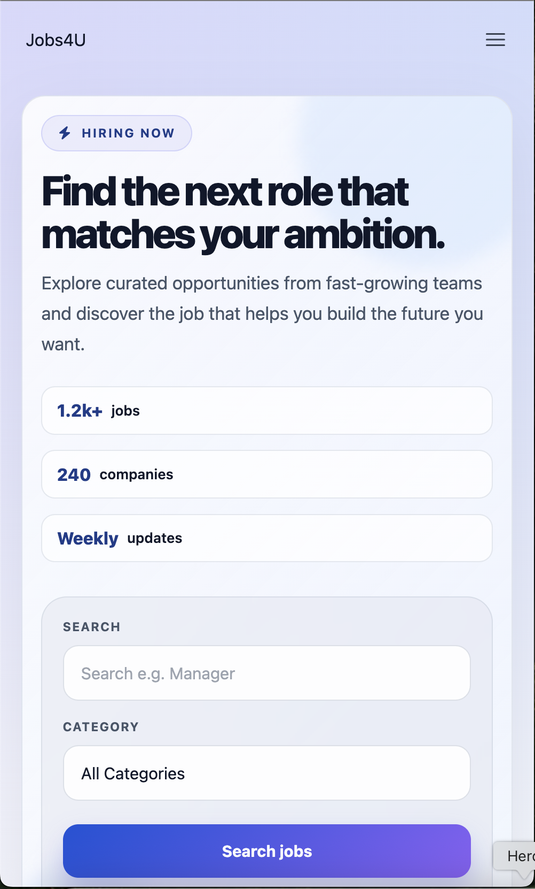
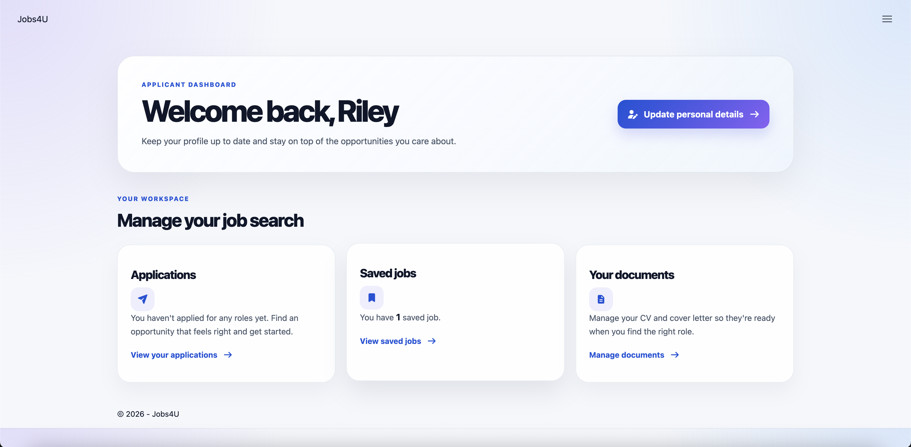
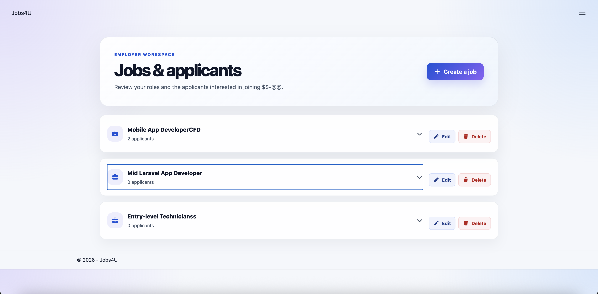
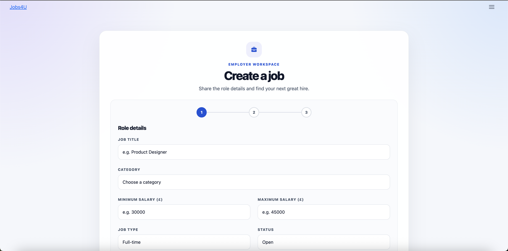
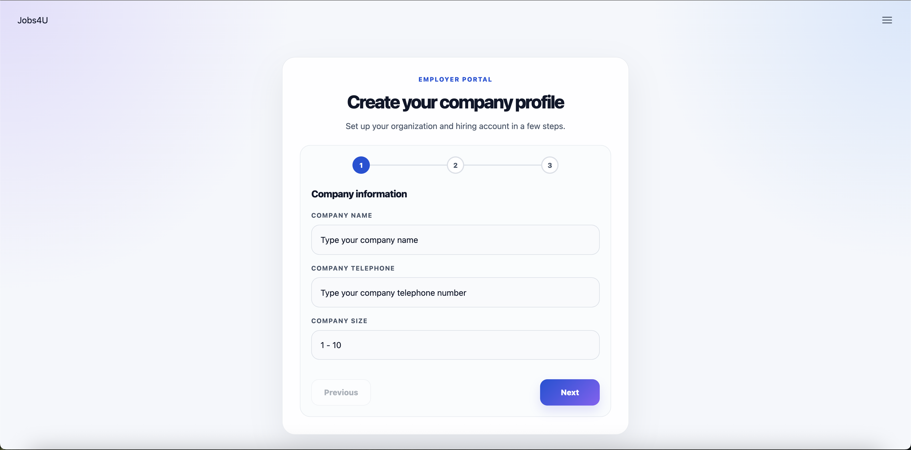

# 💼 JobBoardApp

A Laravel job board platform for connecting job seekers with employers through searchable listings, saved roles, and application workflows.

This project is designed as a practical Laravel application for exploring recruitment workflows, authentication, dashboard logic, and relationship-based data modeling in a real-world domain.

---

## 📋 Table of Contents

* [About](#-about)
* [Features](#-features)
* [Application Preview](#-application-preview)
* [Technology Stack](#-technology-stack)
* [Application Structure](#-application-structure)
* [Database Structure](#-database-structure)
* [Authentication & User Roles](#-authentication--user-roles)
* [Installation](#-installation)
* [Environment Configuration](#-environment-configuration)
* [Database Setup](#-database-setup)
* [Running the Application](#-running-the-application)
* [Project Architecture](#-project-architecture)
* [Validation](#-validation)
* [Security Considerations](#-security-considerations)
* [Future Improvements](#-future-improvements)
* [Learning Objectives](#-learning-objectives)
* [Project Status](#-project-status)

---

## 📖 About

JobBoardApp is a Laravel-based recruitment platform that allows users to browse available roles, save interesting listings, and submit applications. Employers can register, create job posts, edit listings, and review candidates linked to each role.

Users can:

* Browse job opportunities on a public landing page
* Search and filter jobs by keyword or category
* View detailed role descriptions
* Save jobs to a personal wishlist
* Apply to listings
* Access candidate and employer dashboards
* Manage employer job posts and applicant data

The project is being used as a portfolio and learning application to build experience with Laravel MVC architecture, Eloquent relationships, authentication, role-based access, validation, and dashboard-driven user flows.

---

## ✨ Features

### 👤 User Authentication

* Candidate registration and login
* Employer registration and login
* Protected routes for authenticated users
* Session-based access control
* Role-aware navigation and dashboards

### 💼 Job Discovery

* Browse all current job listings
* Filter by keyword and category
* View job details, location, and salary information
* Review opportunities in a user-friendly interface

### 🧾 Applications & Saved Jobs

* Save jobs for later review
* Submit job applications
* View saved jobs from a user's dashboard
* Track application-related activity

### 🏢 Employer Management

* Create and publish jobs
* Edit and remove job listings
* Manage employer profile details
* Review applicants connected to posted roles

---

## 🖥️ Application Preview

The screenshots below show the public job search, applicant dashboard, and employer workflows.

| Job search | Mobile job search |
| --- | --- |
|  |  |

| Applicant dashboard | Employer jobs and applicants |
| --- | --- |
|  |  |

| Create a job listing | Employer registration |
| --- | --- |
|  |  |

---

## 🛠️ Technology Stack

### Backend

* PHP
* Laravel
* Laravel Eloquent ORM
* SQLite

### Frontend

* Blade templates
* Tailwind CSS
* HTML5
* CSS3
* JavaScript

### Development Tools

* Composer
* npm
* Laravel Herd
* Vite

---

## 📁 Application Structure

The application follows Laravel's standard structure with custom models, controllers, and request handling for the job board workflow.

```text
app/
├── Http/
│   ├── Controllers/
│   ├── Middleware/
│   └── Requests/
│
├── Models/
│   ├── User.php
│   ├── JobListing.php
│   ├── Company.php
│   ├── Application.php
│   └── SavedJob.php
│
├── Services/
│   └── ...
│
└── ...
```

---

## 🗄️ Database Structure

The main entities are:

```text
User
 ├── Applications
 ├── SavedJobs
 └── Job Listings (for employers)

Company
 └── Job Listings

JobListing
 ├── Category
 ├── Applications
 └── SavedJobs
```

### Users

Stores application users, including candidates and employers.

Example fields:

```text
id
name
email
password
role
company_id
created_at
updated_at
```

### Companies

Stores employer or business profile data.

Example:

```text
id
company_name
company_tel
company_size
created_at
updated_at
```

### Job Listings

Stores published roles and job details.

Example:

```text
id
company_id
title
slug
description
location
salary_min
salary_max
job_type
category_id
created_at
updated_at
```

### Applications

Tracks candidate applications for job openings.

Example:

```text
id
job_id
user_id
status
created_at
updated_at
```

### Relationships

A company can have many job listings:

```php
public function jobListings()
{
    return $this->hasMany(JobListing::class);
}
```

A job listing belongs to a company:

```php
public function company()
{
    return $this->belongsTo(Company::class);
}
```

A user can have many saved jobs and applications:

```php
public function savedJobs()
{
    return $this->hasMany(SavedJob::class);
}
```

---

## 🔐 Authentication & User Roles

The application uses Laravel authentication and role-based middleware to control access to different sections of the app.

Unauthenticated users are prevented from accessing protected routes such as employer dashboards and candidate-specific pages.

The general flow is:

```text
Landing Page
    ↓
User Login / Register
    ↓
Controller
    ↓
Middleware / Role Check
    ↓
Dashboard / Protected Area
```

This allows separate experiences for:

* candidate users
* employer users
* protected employer administration routes

---

## 🚀 Installation

### 1. Clone the Repository

```bash
git clone <repository-url>
```

Navigate into the project:

```bash
cd JobBoardApp
```

### 2. Install PHP Dependencies

```bash
composer install
```

### 3. Install JavaScript Dependencies

```bash
npm install
```

### 4. Create the Environment File

```bash
cp .env.example .env
```

### 5. Generate the Application Key

```bash
php artisan key:generate
```

### 6. Create the SQLite Database File (if needed)

```bash
touch database/database.sqlite
```

### 7. Run Migrations

```bash
php artisan migrate
```

Alternatively, the project includes a setup script:

```bash
composer run setup
```

---

## ⚙️ Environment Configuration

Configure the `.env` file with the appropriate app and database settings.

Example:

```env
APP_NAME="JobBoardApp"
APP_ENV=local
APP_KEY=
APP_DEBUG=true

DB_CONNECTION=sqlite
```

For SQLite, ensure the app can access the database file:

```bash
touch database/database.sqlite
```

---

## 🗃️ Database Setup

Run the database migrations:

```bash
php artisan migrate
```

If you want to rebuild the database from scratch:

```bash
php artisan migrate:fresh
```

> ⚠️ `migrate:fresh` deletes all existing tables and data.

If database seeders are available:

```bash
php artisan db:seed
```

Or:

```bash
php artisan migrate --seed
```

---

## ▶️ Running the Application

Start the Laravel development server:

```bash
php artisan serve
```

Start Vite for frontend assets:

```bash
npm run dev
```

The application can then be viewed in the browser using the Laravel local development URL.

---

## 🏗️ Project Architecture

The application aims to keep controllers focused on HTTP concerns while moving business logic into dedicated services and actions where appropriate.

The general flow is:

```text
HTTP Request
     ↓
Route
     ↓
Controller
     ↓
Request Validation
     ↓
Service / Action
     ↓
Eloquent Model
     ↓
Database
```

### Controllers

Controllers handle entry points for routes and coordinate requests with the relevant service or model logic.

### Form Requests

Request classes validate incoming form data before it reaches the controller logic.

Example validation patterns include:

* required fields
* email validation
* category or job existence checks
* salary and location validation
* optional fields and nullable values

### Services

Services are used for reusable logic such as:

* user authentication
* job creation and updates
* application storage
* saved job management

---

## ✅ Validation

Validation is handled through Laravel form request classes and controller-driven checks rather than placing all logic directly in views or routes.

Typical validation includes:

* required job details
* valid company or category IDs
* email validation for user data
* field length and string rules
* conditional status checks for applications

---

## 🔒 Security Considerations

Job board applications require careful handling of user data and application records.

Important considerations include:

* Passwords should never be stored as plain text.
* Authentication should use Laravel's hashing and built-in auth features.
* Protected routes should be guarded by middleware.
* User input should always be validated.
* CSRF protection should remain enabled.
* Sensitive data should not be exposed in views or logs.
* Production deployments should use HTTPS.
* Application secrets should never be committed to version control.

> **Important:** This project is primarily a Laravel learning and portfolio application and should not be treated as a production-ready recruitment platform without a more thorough security review and additional protections.

---

## 🔮 Future Improvements

Potential future features include:

* [ ] Advanced job filtering and sorting
* [ ] Employer company profile pages
* [ ] Resume upload support
* [ ] Application status tracking
* [ ] Search by location and remote work type
* [ ] Recruiter messaging or interview scheduling
* [ ] Admin moderation tools
* [ ] Job alerts and notifications
* [ ] User dashboards for saved jobs and applications
* [ ] Pagination and better job card UX
* [ ] Automated tests and feature coverage
* [ ] Improved accessibility and responsiveness
* [ ] Dark mode

---

## 📚 Learning Objectives

This project is designed to provide hands-on experience with:

* Laravel MVC architecture
* Routing and middleware
* Controllers and form requests
* Eloquent ORM and model relationships
* Authentication and role-based access
* Database migrations and schema design
* Tailwind and responsive front-end layout
* CRUD operations for job data and user actions
* Real-world business workflow modeling

---

## 📌 Project Status

**Work in Progress**

The application is actively being developed as a practical Laravel portfolio project focused on recruitment workflows, employer operations, and job search functionality.
